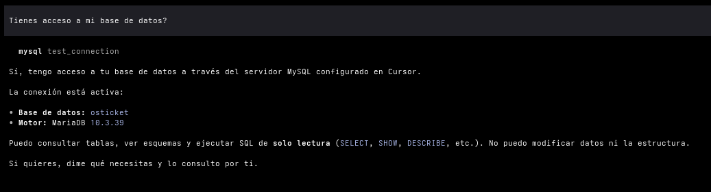

# MCP Database — documentación técnica

Para quien mantiene el proyecto o necesita configurarlo a mano. La guía para usuarios finales está en el [README](../README.md).

Servidores MCP en Python para conectar asistentes de IA a **MySQL**, **Oracle**, **SQL Server**, **Informix** y **PostgreSQL**. Hay cinco servidores independientes en el mismo repo:

| Servidor | Módulo | Entrada MCP | Driver extra en la PC |
|----------|--------|-------------|------------------------|
| MySQL | `mcp_mysql` | `mysql` | No (pip alcanza) |
| Oracle | `mcp_oracle` | `oracle` | No (pip / thin mode) |
| PostgreSQL | `mcp_postgresql` | `postgresql` | No (pip / `psycopg`) |
| SQL Server | `mcp_sqlserver` | `sqlserver` | **Sí** — ODBC Driver 17/18 |
| Informix | `mcp_informix` | `informix` | **Sí** — Client SDK / ODBC IBM |

## Qué hace el instalador

`resources/Scripts/setup_claude_code.sh` (Linux / macOS) y `setup_claude_code.ps1` (Windows, lanzado por `setup_claude_code.cmd`) dejan todo listo sin necesitar Python instalado ni permisos de administrador:

1. Preguntan qué motores vas a usar. Con Enter aceptas la sugerencia: los motores que ya tengas configurados en `.env`, o `mysql` la primera vez.
2. Instalan [uv](https://docs.astral.sh/uv/) 0.12.24 en `~/.local/bin` si no está.
3. Instalan Python 3.13 en la carpeta del usuario, sin tocar el Python del sistema:
   - **Linux / macOS:** el Python que descarga uv.
   - **Windows:** el instalador oficial de python.org (3.13.16), en `%LOCALAPPDATA%\Programs\Python\Python313`. El script verifica que esté firmado por la Python Software Foundation antes de ejecutarlo. No se usa el Python de uv porque no está firmado y [Smart App Control](#windows-smart-app-control) lo bloquea.
4. Crean el `.venv` en la raíz del repo e instalan el paquete. Si encuentran un `.venv` creado con otro Python (por una versión anterior del script), lo recrean.
5. Verifican que Python pueda cargar los MCP, para que un problema aparezca aquí y no como "Connection closed" dentro de Claude Code.
6. Copian `.env.example` → `.env` si no existe.
7. Ejecutan `configure_env.py`, que pide los datos de conexión de cada motor elegido, los guarda en `.env` y prueba la conexión en el momento. Si falla, muestra el error y ofrece corregir los datos. La contraseña no se ve al escribirla, y en Linux/macOS el `.env` queda legible solo por el usuario. Si un motor ya está configurado, solo pregunta si quieres cambiarlo. Oracle admite varias bases (ver [perfiles](#oracle-varias-conexiones-perfiles)).
8. Registran en Claude Code cada motor elegido, disponible en todas las carpetas (`claude mcp add --scope user`), y comprueban que arranque. Si ya estaba registrado, lo reemplazan; por eso, si se mueve el repo de carpeta, basta con volver a ejecutar el script. Si no encuentran Claude Code, imprimen los comandos para registrarlos a mano.

Detalles:

- Se pueden ejecutar desde cualquier carpeta; siempre trabajan sobre la raíz del repo.
- Necesitan acceso a internet (astral.sh, github.com y, en Windows, python.org) la primera vez.
- Para no elegir los motores en el menú, pásalos como argumento (nombres o números, `todos` o `ninguno`):

  ```bash
  ./resources/Scripts/setup_claude_code.sh mysql oracle
  .\resources\Scripts\setup_claude_code.cmd mysql
  ```

- Sin terminal interactiva (por ejemplo, lanzado desde otra herramienta) no piden credenciales: hay que completar `.env` a mano, quitando el `#` de cada línea.
- El `.cmd` ejecuta el `.ps1` con `-ExecutionPolicy Bypass` solo para esa ejecución, así que no hace falta cambiar la execution policy de la máquina. Si la empresa fija la política por GPO (directiva de grupo), esa directiva tiene prioridad y el script no correrá: hay que pedir a TI que lo habilite o usar la [instalación manual](#instalación-manual).
- En Linux con VS Code instalado como Flatpak, hay que ejecutar el script desde la terminal del sistema: la terminal integrada corre dentro del sandbox y no encuentra `claude`.

### Windows: Smart App Control

En equipos con Windows 11 que tienen Smart App Control activo, Windows puede bloquear archivos de Python sin firma. El error se ve así:

```
ImportError: DLL load failed while importing unicodedata: Una directiva de Control de aplicaciones bloqueó este archivo.
```

El script evita el caso más común usando el Python oficial (firmado). Algunos paquetes instalados con pip traen archivos `.pyd` sin firma que Smart App Control también puede bloquear; si pasa, el script se detiene y lo indica. La única solución en ese caso es desactivarlo en *Seguridad de Windows → Control de aplicaciones y navegador → Configuración de Smart App Control*, y volver a ejecutar el script. El script no lo desactiva solo: es una protección de todo el equipo, requiere ser administrador y, según la versión de Windows 11, puede no volver a activarse sin reinstalar Windows. En equipos de la empresa, la decisión es de TI.

## Instalación manual

Requiere Python 3.11 o superior.

```bash
git clone https://github.com/EgCooper/MCP-DATABASE.git
cd MCP-DATABASE
python -m venv .venv
```

Activa el entorno virtual:

```bash
# Windows (PowerShell)
.\.venv\Scripts\Activate.ps1

# Linux / macOS
source .venv/bin/activate
```

Instala el paquete (incluye los cinco servidores) y crea el archivo de credenciales (no se sube a git):

```bash
pip install -e .

# Windows
Copy-Item .env.example .env

# Linux / macOS
cp .env.example .env
```

Para completar `.env`, usa el asistente del instalador (pregunta los datos y prueba la conexión):

```bash
python resources/Scripts/configure_env.py mysql oracle
```

O edítalo a mano: quita el `#` de las líneas del motor y completa los valores.

## Drivers para SQL Server e Informix

`pip install -e .` instala `pyodbc`, pero **no** instala el driver del sistema. Sin eso, la conexión falla. El asistente de credenciales detecta los drivers instalados y propone el más reciente.

### SQL Server — ODBC Driver

1. Descarga e instala **Microsoft ODBC Driver 18 for SQL Server** (x64):
   https://learn.microsoft.com/en-us/sql/connect/odbc/download-odbc-driver-for-sql-server
2. Si el instalador lo pide, instala también el [Visual C++ Redistributable](https://learn.microsoft.com/en-us/cpp/windows/latest-supported-vc-redist).
3. Verifica en PowerShell:

   ```powershell
   Get-OdbcDriver | Where-Object { $_.Name -like "*SQL Server*" }
   ```

4. En `.env` va el nombre exacto del driver, por ejemplo `SQLSERVER_DRIVER=ODBC Driver 18 for SQL Server`.

En Linux, además del driver, hace falta unixODBC (Fedora: `sudo dnf install unixODBC`; Ubuntu: `sudo apt install unixodbc`).

### Informix — Client SDK / ODBC

1. Descarga el **IBM Informix Client SDK** (incluye el ODBC Driver). Requiere cuenta/licencia IBM o HCL:
   - https://www.ibm.com/support/pages/download-informix-products
   - https://www.ibm.com/support/fixcentral
   - HCL/Actian ESD: https://esd.actian.com/
2. Instala el Client SDK para **Windows x64**.
3. Verifica en *Orígenes de datos ODBC (64 bits)* que aparezca algo como `IBM INFORMIX ODBC DRIVER`.
4. En `.env`:

   ```env
   INFORMIX_DRIVER=IBM INFORMIX ODBC DRIVER
   INFORMIX_SERVER=ol_informix1410
   ```

`INFORMIX_SERVER` es el nombre del servidor Informix (`INFORMIXSERVER`), no solo el host.

## Registrar los MCP a mano

### Claude Code

El instalador ya registra los MCP en Claude Code. Para hacerlo a mano, ejecuta estos comandos en una terminal normal (no dentro de una sesión de Claude) y desde la raíz del repo (si no, reemplaza `$(pwd)` / `$PWD` por la ruta absoluta al proyecto). `--scope user` deja el MCP disponible en todas las carpetas; sin esa opción, Claude Code lo registra solo para la carpeta donde se ejecutó el comando.

**Linux / macOS:**

```bash
claude mcp add --scope user mysql -- "$(pwd)/.venv/bin/python" -m mcp_mysql
claude mcp add --scope user oracle -- "$(pwd)/.venv/bin/python" -m mcp_oracle
claude mcp add --scope user postgresql -- "$(pwd)/.venv/bin/python" -m mcp_postgresql
claude mcp add --scope user sqlserver -- "$(pwd)/.venv/bin/python" -m mcp_sqlserver
claude mcp add --scope user informix -- "$(pwd)/.venv/bin/python" -m mcp_informix
```

**Windows (PowerShell):**

```powershell
claude mcp add --scope user mysql -- "$PWD\.venv\Scripts\python.exe" -m mcp_mysql
claude mcp add --scope user oracle -- "$PWD\.venv\Scripts\python.exe" -m mcp_oracle
claude mcp add --scope user postgresql -- "$PWD\.venv\Scripts\python.exe" -m mcp_postgresql
claude mcp add --scope user sqlserver -- "$PWD\.venv\Scripts\python.exe" -m mcp_sqlserver
claude mcp add --scope user informix -- "$PWD\.venv\Scripts\python.exe" -m mcp_informix
```

Registra solo los motores que vayas a usar. El MCP lee las credenciales al arrancar, así que si cambias `.env` después, reinicia Claude Code. Verifica con `claude mcp list` y quita un servidor mal configurado con `claude mcp remove --scope user <nombre>`.

### Otros clientes (Cursor, Claude Desktop, VS Code…)

Los servidores son MCP estándar (stdio), así que funcionan con cualquier cliente compatible; las credenciales siguen viniendo del `.env` del repo, no de la configuración del cliente. El instalador todavía registra solo en Claude Code.

Para **Cursor** y **Claude Desktop**, cada servidor trae un comando que agrega su entrada al archivo del cliente sin borrar otros MCPs:

```bash
python -m mcp_mysql setup                    # Cursor (por defecto)
python -m mcp_mysql setup --client claude    # Claude Desktop (no Claude Code)
python -m mcp_mysql setup --dry-run          # muestra el resultado sin escribir
python -m mcp_mysql setup --print            # solo imprime el JSON
```

Lo mismo con `mcp_oracle`, `mcp_postgresql`, `mcp_sqlserver` y `mcp_informix` (o los comandos `mcp-mysql-setup`, `mcp-oracle-setup`, etc.). Después, reinicia el cliente y prueba con `test_connection`.

Para otros clientes, agrega a mano la entrada (`command` = Python del `.venv`, `args` = `["-m", "mcp_mysql"]`) en su archivo de configuración:

| Cliente | Archivo de configuración | Clave |
|---------|--------------------------|-------|
| Cursor | `~/.cursor/mcp.json` (Windows: `%USERPROFILE%\.cursor\mcp.json`) | `mcpServers` |
| Claude Desktop | Windows: `%APPDATA%\Claude\claude_desktop_config.json`; macOS: `~/Library/Application Support/Claude/claude_desktop_config.json`; Linux: `~/.config/Claude/claude_desktop_config.json` | `mcpServers` |
| VS Code + Copilot / Copilot CLI | `~/.copilot/mcp-config.json` | `mcpServers` |
| Gemini CLI | `~/.gemini/settings.json` | `mcpServers` |
| Google Antigravity | `~/.gemini/config/mcp_config.json` | `mcpServers` |
| Codex CLI | `~/.codex/config.toml` (o `codex mcp add`) | `[mcp_servers.<nombre>]` |

## Oracle: varias conexiones (perfiles)

Un solo MCP `oracle` puede apuntar a varias bases. El asistente de credenciales los configura si respondes que vas a usar más de una base; a mano, en `.env`:

```env
ORACLE_CONNECTIONS=B1,B2
ORACLE_DEFAULT=B1

ORACLE_B1_USER=
ORACLE_B1_PASSWORD=
ORACLE_B1_HOST=
ORACLE_B1_PORT=
ORACLE_B1_SID=

ORACLE_B2_USER=
ORACLE_B2_PASSWORD=
ORACLE_B2_HOST=
ORACLE_B2_PORT=
ORACLE_B2_SID=
```

Uso en tools: `list_connections`, luego `list_tables(connection="B2")`, `execute_query(..., connection="B2")`, etc. Si se omite `connection`, se usa `ORACLE_DEFAULT`.

El modo simple (una sola base) sigue funcionando con `ORACLE_USER` / `ORACLE_DSN` sin `ORACLE_CONNECTIONS`.

## Tools disponibles

Las mismas tools en los cinco servidores (solo lectura):

| Tool | Descripción |
|------|-------------|
| `list_connections` | Lista perfiles Oracle configurados (solo Oracle por ahora) |
| `test_connection` | Verifica la conexión |
| `list_tables` | Lista tablas |
| `list_views` | Lista vistas |
| `describe_table` | Columnas de una tabla |
| `list_indexes` | Índices de una tabla |
| `list_foreign_keys` | FKs de una tabla o de toda la DB |
| `find_column` | Busca columnas por nombre (`%` wildcard) |
| `sample_rows` | Muestra filas de ejemplo (máx. 100) |
| `count_rows` | Cuenta filas de una tabla |
| `execute_query` | SQL libre de solo lectura |

**MySQL / PostgreSQL:** `SELECT`, `SHOW`/`EXPLAIN` donde aplique, `WITH` (usa `LIMIT`).

**Oracle / SQL Server / Informix:** `SELECT` / `WITH` (límites con `FETCH FIRST` / `TOP` / `FIRST`).

`execute_query` rechaza múltiples sentencias (`;`) y keywords de escritura (`INSERT`, `UPDATE`, `DELETE`, `DROP`, etc.). En producción usa además un usuario de base de datos de solo lectura.

### Reportes fijos (solo MySQL)

Para reportes que siempre deben ejecutar la misma query (y no una armada por el modelo), el servidor MySQL expone tools que leen el SQL desde `resources/querys/`:

| Tool | Query | Parámetros |
|------|-------|------------|
| `report_hours` | `resources/querys/hours.sql` | `desde`, `hasta` en formato `YYYYMMDD` (ej. `20260101`, `20260826`) |

- El SQL se lee del archivo en cada llamada: si editas `hours.sql`, el cambio aplica sin reiniciar el MCP.
- `hours.sql` usa los marcadores `%(desde)s` y `%(hasta)s`; no se puede pegar tal cual en otro cliente SQL. Para eso está `hours.original.sql` (con fechas fijas).
- Estos reportes no pasan por el validador de `execute_query` (la query usa la función `REPLACE()`) ni se recortan con `LIMIT`.

## Notas

- Los comandos `python -m mcp_*` arrancan el servidor stdio; lo lanza el cliente.
- Las credenciales viven en `.env`, no en la configuración del cliente. Los servidores lo leen sin expandir `${...}`, para que las contraseñas con ese texto funcionen.
- MySQL, Oracle y PostgreSQL no requieren instalador de driver aparte.
- SQL Server e Informix **sí** requieren driver/SDK instalado en el sistema además de `pyodbc`.

## Estructura

```
MCP-DATABASE/
├── pyproject.toml
├── .env.example
├── src/
│   ├── mcp_mysql/
│   ├── mcp_oracle/
│   ├── mcp_postgresql/
│   ├── mcp_sqlserver/
│   └── mcp_informix/
├── resources/
│   ├── querys/          # SQL de reportes fijos (ej. hours.sql)
│   └── Scripts/         # setup_claude_code.sh / .ps1 / .cmd y configure_env.py (credenciales)
├── docs/
│   └── DESARROLLO.md    # este documento
└── README.md            # guía para usuarios finales
```

## Prueba


